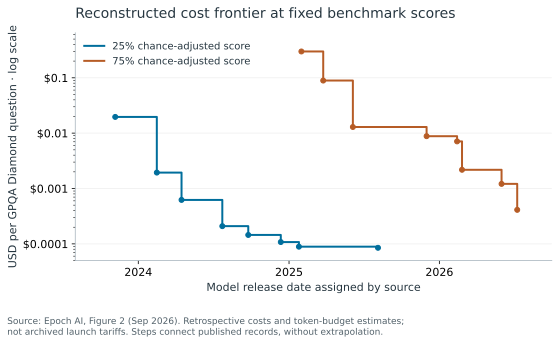
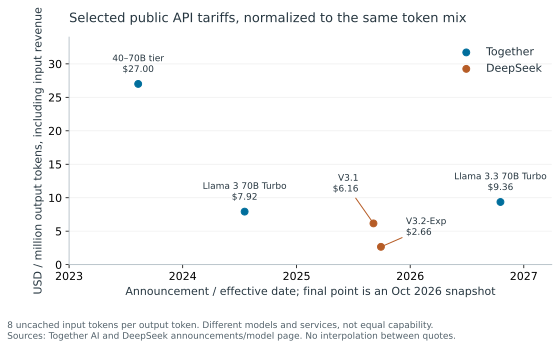
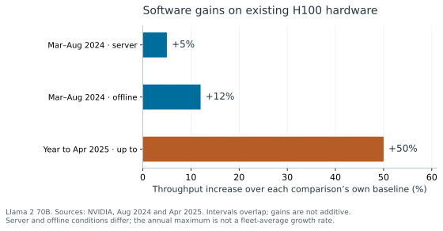

# What are the costs of serving a language model?

!!! abstract "Summary: TODO one sentence summary"
    - TODO summary bullets

As LLMs become useful tools for research and engineering,
questions of cost become important:

> - Might prices rise as providers pursue profitability, squeezing customers who become reliant?
> - Might declining costs make these tools more accessible in lower-purchasing-power regions?
> - How might changes in compute hardware, algorithms, energy, and financing change costs?

We can't know for sure, particularly looking at frontier models from public data.

Instead, this post helps you explore the cost factors for yourself.
We'll make a simple estimate of the costs of buying equipment, renting datacenter space and serving inference on a language model (assuming the model is already trained).
We'll then compare this estimate to actual market prices for inference on open-weights models.

This post is meant for technical- or business-minded readers seeking an introduction to the infrastructure behind their chat / coding agent interface, and what it costs to run.

## A simple estimate of datacenter project finance

<ai-dc-project-finance-widget>Enable JavaScript to explore the interactive cost model. The model and its assumptions are described below.</ai-dc-project-finance-widget>

TODO "visual abstract" diagram explaining the cost-estimate method to a reader at a glance.

To understand the factors that influence cost, we'll use a *project finance*
model of an inference provider that owns its GPU servers and rents space in an
existing datacenter. The project pays upfront for servers, networking equipment
and deployment, using a mix of equity and loans. A brief commissioning period
separates equipment payment from the start of inference revenue; rent and loan
interest accrue during that delay.

During operation, the project sells inference and pays colocation rent,
electricity and other operating costs. Rent is charged per reserved kW of IT
capacity. Electricity is charged separately on consumed power, multiplied by PUE
to include cooling and electrical losses. The *throughput* and *utilization* of
the computing equipment determine how many tokens the project serves each month.

Over time, the price per output token and throughput change.
Price decreases, representing market competition from newer, better hardware and more capable models.
Throughput increases as software improvements squeeze more performance out of the hardware.
Both are modeled as a fixed rate compounding monthly, selected via the "price and throughput trajectory" dropdown.
Empirically, from 2024-26, prices have fallen rapidly (holding model-intelligence-class constant) and throughput has increased somewhat (holding hardware constant),
see [Trends in the key factors](#trends-in-the-key-factors).

The project ends when its equipment retires. To keep the model simple, we assume
the lease can end at any time without penalty, equipment has no resale value,
and remaining debt is repaid at retirement. We exclude taxes and government incentives.

We jointly solve for the retirement time and the initial price per output
token which meet investors' equity return hurdle at the minimum price. This assumes perfect
foreknowledge of the selected price and throughput trajectory, within a maximum
operating life.

This method is based on [Lazard's Levelized-Cost-of-Energy (LCOE)](https://www.lazard.com/research-insights/levelized-cost-of-energyplus-lcoeplus/) analysis,
the industry-standard method for modeling the cost of energy generation.
Lazard's LCOE estimates USD/MW-hr to pay back an energy project;
this post estimates USD/MTok to pay back a datacenter project.
Unlike Lazard's method, which assumes constant price and capacity,
this method assumes price and throughput vary with time.
While Lazard's uses a fixed facility lifetime, this method solves for the optimal lifetime given a fixed rate of price decline.

??? info "Training costs not included"
    This method only accounts for the costs of inference, not the costs of research and model training.
    That's accurate for open-weights inference providers: they get the model weights for free.
    Within this method, one way to simulate paying back training costs is to require a higher IRR.
    Another way is to assume only a fraction of the project's capacity is sold for revenue, with the remainder used internally for training.

### Key factors: throughput and cost of computing hardware

*Throughput* measures how many tokens can be served per second per unit-power-rating of IT capacity, with units of MTok/s/MW. Token cost scales like `1 / throughput`. Of our estimate's parameters, throughput has the biggest influence on cost, and is the least constrained from public data.

Throughput depends on model architecture and the inference engine that executes it, together called *algorithmic efficiency*, and hardware efficiency.

- *Architecture's* first-order effect: bigger models have lower throughput (holding constant compute and memory resources). Some architectures, like mixture-of-experts, make models faster by evaluating sections of the model in parallel, or only using some sections to predict each token.
- The *inference engine* is the software running the model to generate token predictions. A better inference engine can run the same model faster on the same hardware.
- As *hardware* improves, more efficient GPUs do more computation per second per installed capacity. (In this post, throughput is normalized per power-rating of installed IT capacity, not per the power the GPU actually consumes in a given moment.)

Architecture, inference engine, and hardware are coupled. For example, some GPUs can do many more operations per second on number representations with fewer bits (e.g. [BF16](https://en.wikipedia.org/wiki/Bfloat16_floating-point_format) or 8-bit integers). This requires *quantization*: making the model and inference engine use fewer-bit representations.

Even for the same LLM architecture and same inference engine on the same hardware, throughput is not a single number. *Concurrency*, how many users the hardware serves at once, creates a trade-off between throughput and per-user latency.

There is public benchmark data for throughput of open-weights models, on open-source inference engines, on modern hardware (e.g. [InferenceX](https://inferencex.semianalysis.com/)), and this post's estimates are calibrated with it [below](#simple-cost-estimates-vs-actual-price-of-open-weights-llms).
Recent public benchmarks have throughput on the order of 0.1-10 MTok/s/MW (benchmarks run in mid-2026 on late-2024 B200 hardware).
However, it is not publicly known how the architecture of these open models compares to frontier models. We should assume open inference engines (like vLLM) provide a lower bound on performance for frontier providers, who have both the incentive and resources to develop more efficient inference engines.

*Capital expense* also has a large impact on cost, and is better-constrained by public data than throughput. The widget uses about $29M/MW of installed IT capacity for B200 servers, networking and deployment. Facility construction is paid for through colocation rent rather than project capital.

### Electricity availability matters more than cost

TODO free vs highest US grid rates changes price by TODO percent.

### Financing costs

TODO sensitivity to interest rates.
How might rising interest rates increase the break-even price of projects wiht very front-loaded costs?

## Simple cost estimates vs actual price of open-weights LLMs

TODO

Competitive commodity market --> prices likely reflect costs.

## Trends in the key factors

<!-- Historical figures and factual captions; interpretation to be written by the author. -->

*Retrospective benchmark costs assigned to model release dates, not archived launch tariffs. Thresholds are chance-adjusted accuracy; on four-choice GPQA, 25% and 75% correspond to 43.75% and 81.25% raw accuracy. Includes model switching and token-budget estimates. Source: [Epoch AI report](https://epoch.ai/publications/the-plunging-price-of-thought) and [published Figure 2 data](https://github.com/droodman/inference-cost/blob/9163c17ee7217b9f09ac51bcc71ed64c18c04bc8/output/slides/Figure%202.csv).*

*Dated quotes for different models and services, not a fixed-capability price index. Each value is output tariff + 8 × input tariff. The final Together point is an October 18, 2026 snapshot, not its release price. Sources: Together [2023](https://www.together.ai/blog/august-2023-pricing-update), [2024](https://www.together.ai/blog/together-inference-engine-2), [current model page](https://www.together.ai/models/llama-3-3-70b); DeepSeek [V3.1 effective-date announcement](https://api-docs.deepseek.com/news/news250821/) and [V3.2 price table](https://api-docs.deepseek.com/img/v3_2_price_en.jpeg).*

*Separate, overlapping comparisons; do not compound these gains. The 2024 comparison uses eight H100 GPUs at 700 W each; server and offline benchmarks have different latency requirements. The annual maximum is vendor-reported, not a fleet average, and its source includes an unverified-results caveat. Sources: NVIDIA [August 2024, Table 3](https://developer.nvidia.com/blog/nvidia-blackwell-platform-sets-new-llm-inference-records-in-mlperf-inference-v4-1/) and [April 2025](https://developer.nvidia.com/blog/nvidia-blackwell-delivers-massive-performance-leaps-in-mlperf-inference-v5-0/).*

TODO author interpretation. Related: [Artificial Analysis cost-per-task trends](https://artificialanalysis.ai/trends#language-model-cost-per-intelligence-index-task-by-intelligence-index-threshold-over-time).

---

TODO footnote on use of AI in this blog post

TODO final editing pass per *Style: Lessons in Clarity and Grace*.
